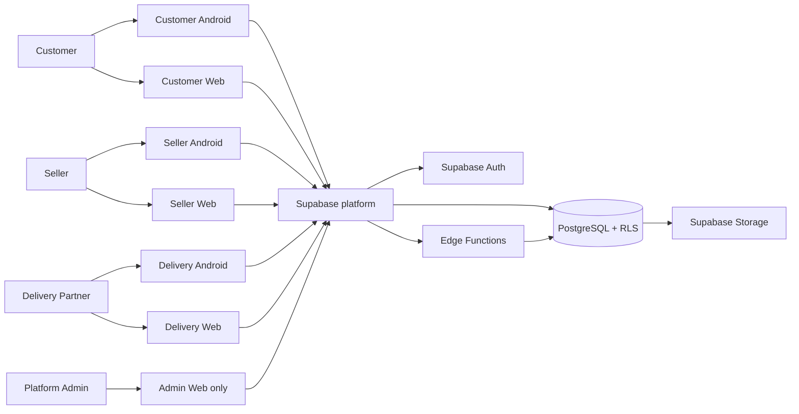
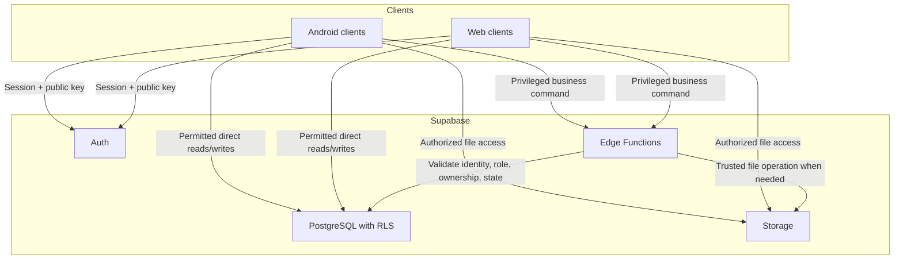
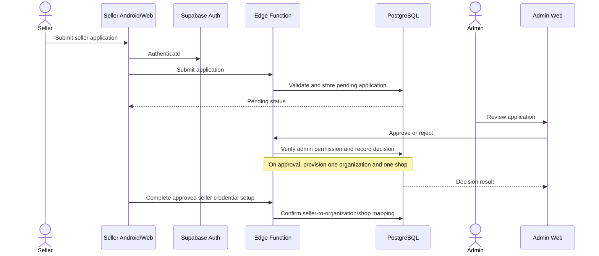

# MALRO — Architecture (Layer 2)

**Status:** Draft for product-owner review  
**Date:** 2026-11-11  
**Depends on:** [System Design — Layer 1](./system-design.md)  
**Approved tenant rule:** One Seller = One Organization = One Shop

## 1. Architecture goals and constraints

MALRO is an existing Barmer-first marketplace, not a greenfield rewrite. This architecture documents the direction for evolving the current repository while preserving working services and approved technology choices.

Goals:

- Keep Customer, Seller, and Delivery experiences available on Android and web.
- Provide a separate **Admin Web panel only**. There is no Admin Android app.
- Keep one authoritative backend and database for all clients.
- Enforce authorization at trusted server/database boundaries; client-side route guards are UX only.
- Keep clear logical module boundaries without introducing independently deployed microservices prematurely.
- Support gradual implementation and verification of the customer → seller → admin → delivery workflow.

Non-goals for this layer:

- No database schema changes or migrations.
- No new framework, backend host, payment provider, map provider, Redis, or job queue.
- No claim that all workflows or clients are already production-ready.
- No forced rewrite of existing apps or deployed services.

## 2. System context

### Product surfaces

| Surface | Roles | Runtime / delivery |
|---|---|---|
| Customer Android | Customer | Kotlin + Jetpack Compose; Android build/release workflow |
| Customer Web | Customer | React + TypeScript + Vite; hosted on Render |
| Seller Android | Seller | Kotlin + Jetpack Compose; Android build/release workflow |
| Seller Web | Seller | React + TypeScript + Vite; hosted on Render |
| Delivery Android | Delivery Partner | Kotlin + Jetpack Compose; Android build/release workflow |
| Delivery Web | Delivery Partner | React + TypeScript + Vite; hosted on Render |
| Admin Web | Platform Admin | React + TypeScript + Vite; hosted on Render |

The web clients are separate deployed surfaces, not one combined Admin/Seller application. The Admin panel is web-only.

### Context diagram



Supabase is the shared backend platform. Clients use the public project URL and publishable/anon key, subject to RLS. Privileged credentials remain server-side and must never be embedded in Android or web bundles.

## 3. High-level architecture

### Chosen shape: Supabase-based modular monolith

MALRO uses a **modular monolith** at the logical application/domain level, implemented on the existing Supabase platform:

- **Supabase Auth** — identity and session establishment.
- **PostgreSQL** — authoritative relational data and transaction boundaries.
- **Row Level Security (RLS)** — row-level access enforcement for direct client data access.
- **Supabase Edge Functions** — trusted application operations requiring validation, privileged access, multi-step orchestration, or secrets.
- **Supabase Storage** — file/object storage with private buckets and scoped access policies where required.
- **Render** — hosting for the separate web applications.
- **Android clients** — native Kotlin + Jetpack Compose applications.

“Modular monolith” describes logical ownership and boundaries; it does **not** mean MALRO currently has a separate always-on API server. Edge Functions are deployed functions within Supabase. PostgreSQL remains the transaction and persistence boundary.

### Runtime and request flow



### Request path rules

1. A client obtains an authenticated session through Supabase Auth.
2. A direct database request is evaluated under the caller's JWT and applicable RLS policies.
3. Any privileged or multi-record business command is sent to a trusted Edge Function.
4. The function validates the request shape, authenticated identity, role, tenant ownership, workflow state, and relevant business rules.
5. The database performs the authoritative write, using a transaction/RPC where atomicity is required.
6. The response contains only data the caller is allowed to see. Errors are safe and do not expose secrets, stack traces, or other users' records.

A client-supplied user ID, organization ID, shop ID, role, price, total, order status, payment status, or delivery assignment is never sufficient proof of authorization or truth.

## 4. Logical backend modules

These are domain boundaries within the shared Supabase backend, not separate microservices or separate databases.

| Module | Owns | Main responsibilities |
|---|---|---|
| Identity & Access | Auth integration, profile and role rules | Session identity, role provisioning, permission checks, account lifecycle |
| Seller Onboarding & Shops | Seller applications, organization/shop relationship | Application review, approval, one-seller/one-organization/one-shop invariant, shop profile |
| Catalogue | Categories, products, availability and media metadata | Product discovery, seller-owned catalogue management, moderation boundaries |
| Orders & Checkout | Orders, order items, pricing snapshots and order events | Single-shop order creation, authoritative totals, stock checks, allowed state transitions |
| Delivery | Delivery partner records, assignments, delivery progress and location workflows | Assignment checks, assigned-job visibility, pickup/drop-off progress, purpose-limited location |
| Platform Administration | Platform-level operational actions and audit trail | Seller/delivery approval, assignment, support exceptions, configuration and audit review |
| File Storage | Object metadata and storage policies | Shop images, product images, seller documents and delivery evidence with scoped access |

### Module dependency rules

- Identity & Access is foundational; domain modules consume its trusted identity and authorization decisions.
- Orders may reference Customer, Shop/Organization, and Delivery assignment identifiers, but each module's ownership and access rules remain explicit.
- Delivery access to an order is limited to the assigned delivery task and the minimum data needed to complete it.
- Platform Administration is a privileged application surface, not a tenant. It must use separately granted platform permissions.
- Catalogue and Orders must not trust client-submitted prices or stock state.
- Cross-module writes that must succeed or fail together belong in one database transaction/RPC or one carefully designed trusted server operation.
- Avoid circular module dependencies. Shared types/contracts should remain small and should not become a dumping ground for business logic.

## 5. Core workflow architecture

### Seller onboarding and shop activation



The exact credential setup mechanism and all required KYC fields remain governed by the product decisions and Auth implementation. Approval must not be simulated by a client-side status change.

### Customer order and delivery

```mermaid
sequenceDiagram
  actor Customer
  participant Client as Customer Android/Web
  participant Fn as Trusted order function
  participant DB as PostgreSQL + RLS
  actor Seller
  participant SellerClient as Seller Android/Web
  actor Admin
  participant AdminWeb as Admin Web
  actor Partner as Delivery Partner
  participant DeliveryClient as Delivery Android/Web

  Customer->>Client: Select products from one shop
  Client->>Fn: Place order
  Fn->>DB: Revalidate shop, products, price, stock and address
  DB-->>Fn: Persist order atomically
  Fn-->>Client: Order confirmation
  Seller->>SellerClient: Review incoming order
  SellerClient->>Fn: Accept / reject / pack
  Fn->>DB: Authorize seller and validate transition
  Admin->>AdminWeb: Review eligible delivery task
  AdminWeb->>Fn: Assign delivery partner
  Fn->>DB: Verify admin, partner and order state; record assignment
  Partner->>DeliveryClient: Open assigned task
  DeliveryClient->>Fn: Pickup / delivery progress
  Fn->>DB: Verify assignment and allowed transition
  DB-->>Client: Updated permitted order view
```

This diagram describes the intended trust boundaries, not a claim that every function or screen is already implemented. Existing workflow details and state transitions must be reconciled before implementing or changing them.

## 6. Repository and branch architecture

### Current shared repository structure (observed)

The shared repository currently contains:

```text
.github/
  workflows/
backend/
  migrations/
docs/
  API_CONTRACT.md
  ARCHITECTURE.md
  BACKEND_SETUP.md
  system-design.md
supabase/
  functions/
    admin-review-shop/
    request-seller-onboarding/
    send-sms-textbee/
AGENTS.md
CLAUDE.md
README.md
```

This is the observed shared-repository structure on the Layer 1 branch. It does not imply that all app source directories are present in this shared branch.

### Branch ownership

| Branch | Scope |
|---|---|
| `main` | Shared contracts, architecture, migrations, integration and release coordination |
| `app/customer` | Customer Android |
| `app/seller` | Seller Android |
| `app/delivery` | Delivery Android |
| `web/customer` | Customer web |
| `web/seller` | Seller web |
| `web/delivery` | Delivery web |
| `admin-web` | Admin web only |

There is deliberately no `app/admin` branch in the approved product architecture.

### Branch-local application layout (illustrative)

The following is a logical layout for each app branch, not a claim that every directory currently exists:

```text
Android branch (app/customer, app/seller, app/delivery)
  app/
  gradle/
  build.gradle.kts
  settings.gradle.kts

Web branch (web/customer, web/seller, web/delivery, admin-web)
  src/
    app/
    components/
    features/
    lib/
    styles/
  public/
  package.json
  vite.config.ts

Shared backend / integration branch
  backend/migrations/
  supabase/functions/
  docs/
  .github/workflows/
```

Do not create a cross-app shared Gradle module, monorepo package, or shared deployment solely because it appears in this illustration. Such a structural change needs a separate implementation plan and approval.

## 7. Hosting and deployment boundaries

| Component | Current approved direction | Notes |
|---|---|---|
| Customer Web | Render | Separate service |
| Seller Web | Render | Separate service |
| Delivery Web | Render | Separate service |
| Admin Web | Render | Separate service; web-only |
| Database/Auth/Functions/Storage | Existing Supabase project | Shared backend; production schema must be checked before migrations |
| Android apps | Existing GitHub Actions build/release workflows | Build and release per app branch |

Web deployment should be independent by application branch/service. Backend migrations and Edge Function changes are shared-platform changes and require review for cross-client impact.

A deployment must not be considered successful merely because a build artifact exists. Verify the deployed service, runtime health, and relevant user flow separately.

## 8. Architecture Decision Records (ADRs)

### ADR-001 — Keep the existing Supabase backend platform

**Decision:** Continue with the existing Supabase project: Auth, PostgreSQL/RLS, Edge Functions and Storage.

**Reason:** It is already integrated into the project and provides a common identity and data boundary for all clients.

**Consequences:** Security depends on correctly designed RLS and trusted function authorization. Privileged credentials remain server-side. A separate API server is not introduced by this architecture.

**Status:** Accepted as the current project constraint; reconsider only with explicit product-owner approval and a migration plan.

### ADR-002 — Use logical modules inside a modular monolith

**Decision:** Organize backend responsibilities by domain module while retaining the shared Supabase deployment and PostgreSQL database.

**Reason:** Current product scale and operational needs do not justify microservice complexity. Module boundaries make ownership, tests, authorization and future extraction clearer.

**Consequences:** Cross-module transactions must be designed carefully. Modules must not bypass shared authorization and data ownership rules.

**Status:** Proposed.

### ADR-003 — One Seller = One Organization = One Shop

**Decision:** Every approved seller organization owns exactly one shop.

**Reason:** This is the explicit product-owner decision recorded in Layer 1.

**Consequences:** Seller-owned records are scoped to that organization/shop. Pending applications do not receive tenant access. Future multi-shop support would require a new ADR and data migration plan.

**Status:** Accepted.

### ADR-004 — Admin is Web-only

**Decision:** Platform Admin uses a dedicated Admin Web panel. There is no Admin Android application.

**Reason:** This is the explicit product-owner decision.

**Consequences:** Android app branch lists and deployment plans must not create or assume an `app/admin` target. Admin permissions remain platform-level and server-enforced.

**Status:** Accepted.

### ADR-005 — Keep separate web deployments on Render

**Decision:** Keep Customer, Seller, Delivery and Admin web applications as separate Render services.

**Reason:** These surfaces have distinct audiences, release cadence and access boundaries, and they already have deployed service identities.

**Consequences:** Shared backend contracts must remain compatible across independently deployed clients. A move to a combined web app requires a separate decision.

**Status:** Accepted as current direction.

## 9. Legacy documentation conflicts and reconciliation

The repository contains older documents that do not fully match the current approved product decisions:

| Existing document | Conflict / limitation | Treatment |
|---|---|---|
| `docs/ARCHITECTURE.md` | Describes four Android apps and an `admin-app` / `app/admin` branch | Legacy draft; this Layer 2 document supersedes that Admin-client assumption |
| `docs/BACKEND_SETUP.md` | Refers to four Android app branches and Admin OTP client | Historical implementation notes; must not be treated as approval for an Admin Android app |
| `README.md` | Lists `app/admin` as a branch and describes Admin among product apps without clarifying web-only | Needs a separately reviewed documentation correction |
| `docs/API_CONTRACT.md` | Draft contract describes roles and functions but some workflow and state-machine details may not match current live implementation | Reconcile in a later API/backend layer; do not copy its assumptions blindly |

This Layer 2 task intentionally creates `docs/architecture.md` without silently editing legacy documents or changing application code. A later, separately scoped documentation-cleanup task should update stale references after review.

## 10. Risks, constraints and open decisions

- **Production schema drift:** Repository migration history may not fully represent the current production database. Layer 3 must inspect and reconcile before proposing migrations.
- **Workflow contract drift:** Existing API drafts and deployed Edge Functions may not cover the complete intended order lifecycle. Verify current code and live schema before finalizing backend contracts.
- **Authorization consistency:** RLS, Edge Function checks and UI assumptions can diverge. Tests must prove that the same tenant and assignment rules hold at every entry point.
- **Independent client releases:** Android and web clients may be on different versions. Backend changes should preserve compatibility or include a coordinated rollout plan.
- **Scale and SLOs:** Expected traffic, uptime, latency and recovery targets are not yet defined. Do not invent load limits or claim scalability without measurement.
- **External providers:** Payment, maps, push notification, monitoring and queue providers remain unapproved or unconfirmed. Do not introduce them as architecture dependencies without a decision.

## 11. Layer 2 completion criteria

Layer 2 is ready for review when:

- The architecture matches the approved Layer 1 tenant model.
- Customer, Seller and Delivery have Android and web surfaces; Admin is web-only.
- The Supabase modular-monolith boundary is accurately described.
- Diagrams show clients, trust boundaries and core workflows without implying unimplemented features are live.
- Repository and branch layouts distinguish observed structure from illustrative future organization.
- Legacy conflicts and unresolved decisions are explicit.
- No application code, database schema, production configuration or deployed service is changed by this documentation layer.
